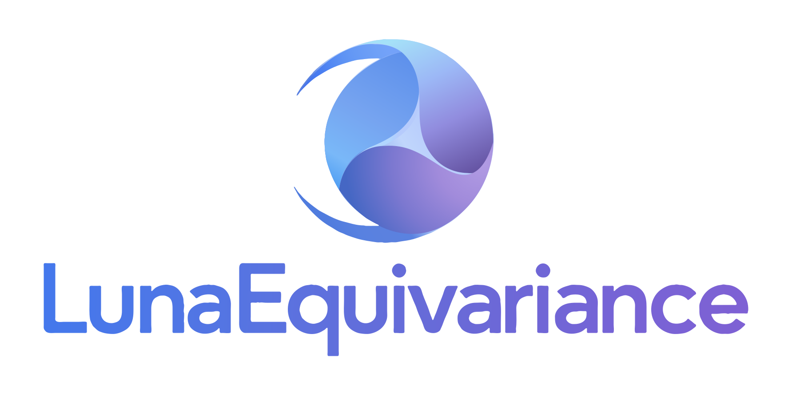
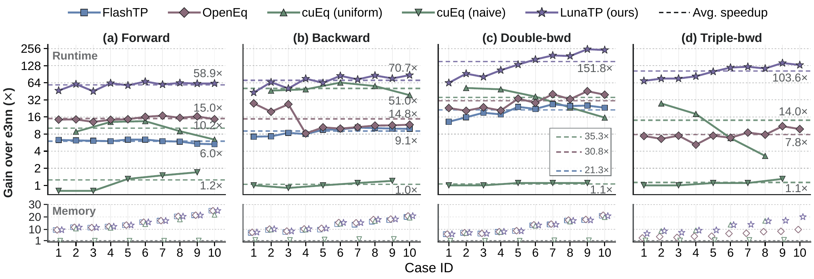
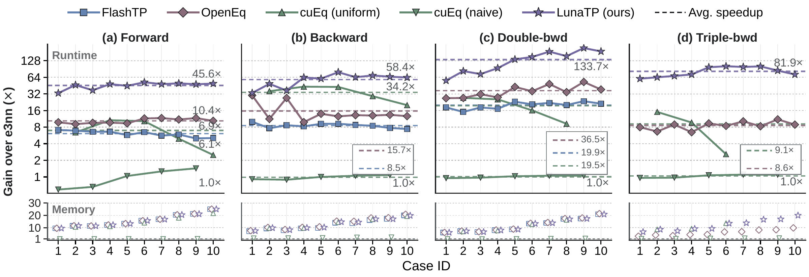

# LunaEquivariance

<p align="center">
  
</p>

High-performance SO(3)-equivariant operators for graph neural networks.

## Features

- **Performance:** order-of-magnitude speedups across a range of operators.
- **Operator coverage:** equivariant layers, fused graph convolutions and attention.
- **Differentiation and precision:** derivatives up to third order, with FP32/FP64 support.
- **PyTorch integration:** easy integration into PyTorch models, with `torch.compile` support.

## Installation and user guides

Install PyTorch first, then install LunaEquivariance:

```bash
pip install LunaEquivariance
```

See the [documentation](https://hpc-ai-team.github.io/LunaEquivariance/) for installation requirements and user guides.

## Supported operators

| Category | Operators |
|---|---|
| Tensor products | [`TensorProduct`](https://hpc-ai-team.github.io/LunaEquivariance/operators/tensor_product.html), [`TensorProductConv`](https://hpc-ai-team.github.io/LunaEquivariance/operators/tensor_product_conv.html) |
| Geometry and linear layers | [`o3.SphericalHarmonics`](https://hpc-ai-team.github.io/LunaEquivariance/operators/spherical_harmonics.html), [`o3.Linear`](https://hpc-ai-team.github.io/LunaEquivariance/operators/linear.html), [`o3.Norm`](https://hpc-ai-team.github.io/LunaEquivariance/operators/norm.html) |
| Activations and regularization | [`nn.Activation`](https://hpc-ai-team.github.io/LunaEquivariance/operators/activation.html), [`nn.Gate`](https://hpc-ai-team.github.io/LunaEquivariance/operators/gate.html), [`nn.NormActivation`](https://hpc-ai-team.github.io/LunaEquivariance/operators/norm_activation.html), [`nn.Dropout`](https://hpc-ai-team.github.io/LunaEquivariance/operators/dropout.html) |
| Normalization | [`nn.EquivariantNorm`](https://hpc-ai-team.github.io/LunaEquivariance/operators/equivariant_norm.html), [`nn.GraphSoftmax`](https://hpc-ai-team.github.io/LunaEquivariance/operators/graph_softmax.html) |
| Self-attention | [`nn.VarlenAttention`](https://hpc-ai-team.github.io/LunaEquivariance/operators/varlen_attention.html), [`nn.VarlenAttentionConv`](https://hpc-ai-team.github.io/LunaEquivariance/operators/varlen_attention_conv.html) |

## How to use LunaEquivariance

LunaEquivariance provides module and functional interfaces. See the
[API reference](https://hpc-ai-team.github.io/LunaEquivariance/api.html) for operator usage and
[examples](examples/) for training and e3nn integration.

UVU tensor product convolution using the module interface:

```python
import torch
from LunaEquivariance import TensorProductConv

dtype = torch.float32  # Use torch.float64 for FP64.

# Define module
conv = TensorProductConv(
    "32x1o", "1x1o", "32x0e", [(0, 0, 0, "uvu", True)],
    internal_weights=False, shared_weights=False, dtype=dtype,
).cuda()

# Alternatively, initialize from an e3nn tensor product:
# from e3nn import o3
# tp = o3.TensorProduct(
#     "32x1o", "1x1o", "32x0e", [(0, 0, 0, "uvu", True)],
#     internal_weights=False, shared_weights=False,
# ).to(device="cuda", dtype=dtype)
# conv = TensorProductConv(tp)

# Prepare inputs
num_atoms, num_edges = 4, 8
src = torch.tensor([1, 3, 0, 2, 1, 3, 0, 2], device="cuda")
dst = torch.tensor([0, 0, 1, 1, 2, 2, 3, 3], device="cuda")  # Edges sorted by destination.
graph = conv.create_graph(src, dst, num_atoms)  # Reuse while connectivity is unchanged.
x = torch.randn(num_atoms, conv.irreps_in1.dim, device="cuda", dtype=dtype, requires_grad=True)
edge_attr = torch.randn(num_edges, conv.irreps_in2.dim, device="cuda", dtype=dtype)
weight = torch.randn(num_edges, conv.weight_numel, device="cuda", dtype=dtype, requires_grad=True)

# Forward
y = conv(x, edge_attr, weight, graph=graph)  # (num_atoms, conv.irreps_out.dim)
```

Using the functional interface with the same inputs:

```python
from LunaEquivariance import prepare_tensor_product, tensor_product_conv

# Initialize once
config = prepare_tensor_product(
    "32x1o", "1x1o", "32x0e", [(0, 0, 0, "uvu", True)],
    shared_weights=False, dtype=dtype, convolution=True,
)

# Forward
y = tensor_product_conv(x, edge_attr, weight, graph=graph, config=config)
```

Check your inputs against e3nn/torch, including numerical errors, timings and speedup:

```python
from LunaEquivariance.utils.testing import check_compatibility

report = check_compatibility(
    conv, (x, edge_attr, weight), kwargs={"graph": graph}, derivative_order=2,
)
```

## Performance

Speedups over e3nn for UVU tensor product convolution on H100, covering forward, backward, double backward and triple backward.

In FP32, LunaTP achieves **58.9–151.8×** average speedup.



In FP64, LunaTP achieves **45.6–133.7×** average speedup.



## Contact

Questions, issues, or feature requests? Feel free to [open an issue](https://github.com/HPC-AI-Team/LunaEquivariance/issues) or [email me](mailto:zhouyuanchang23s@ict.ac.cn).

## Citation

If you use LunaEquivariance in your research, please cite:

```bibtex
@misc{zhou2026lunatpenablingefficientscalable,
    title={LunaTP: Enabling Efficient and Scalable Tensor Product for Equivariant MLIPs},
    author={Yuanchang Zhou and Mingzhen Li and Chen Wang and Xiangyu Zhang and Guangming Tan and Weile Jia},
    year={2026},
    eprint={2610.18393},
    archivePrefix={arXiv},
    url={https://arxiv.org/abs/2610.18393},
}
```

## License

LunaEquivariance is licensed under the [BSD 3-Clause License](LICENSE).
