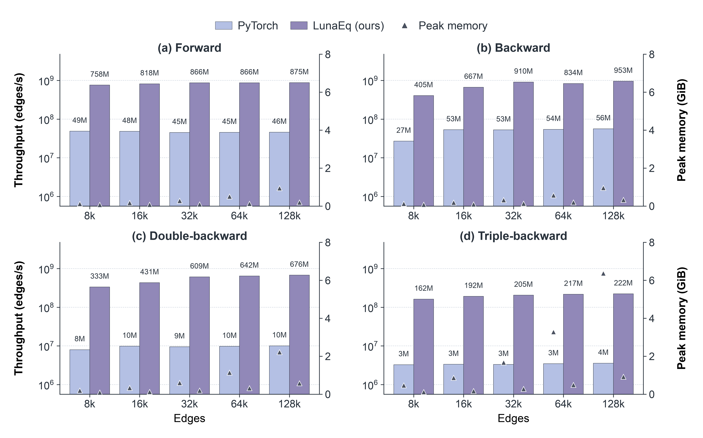

# Attention Scores

````{py:function} LunaEquivariance.so2.attention_scores(inputs, norm_weight, norm_bias, projection, *, eps=1e-5)

Computes per-edge, per-head attention logits by fusing `LayerNorm`,
`SmoothLeakyReLU(0.2)`, and a head-wise dot projection without materializing
intermediate normalized or activated edge tensors.

For each edge {math}`e` and head {math}`h`, the operator normalizes
`inputs[e, h, :]` along the last axis of width `A` with affine parameters
`norm_weight` and `norm_bias` to form {math}`z`, applies the smooth activation

```{math}
a = 0.6 \, z + 0.4 \, z \tanh(z / 2),
```

and returns the projected logits {math}`\sum_{k=1}^{A} a_{e, h, k} \, \text{projection}_{h, k}`.
Derivatives with respect to `inputs`, `norm_weight`, `norm_bias` and `projection`
are supported through third order.

:param inputs: Edge head features of shape `(num_edges, num_heads, A)` with a contiguous last axis.
:type inputs: `torch.Tensor`
:param norm_weight: Contiguous LayerNorm scale of shape `(A,)`.
:type norm_weight: `torch.Tensor`
:param norm_bias: Contiguous LayerNorm bias of shape `(A,)`.
:type norm_bias: `torch.Tensor`
:param projection: Contiguous head-wise projection weights of shape `(num_heads, A)`.
:type projection: `torch.Tensor`
:param eps: Positive finite LayerNorm epsilon. Default: `1e-5`.
:type eps: `float`
:returns: Edge attention logits of shape `(num_edges, num_heads)`, ready for {py:func}`LunaEquivariance.so2.inverse_rotate_reduce`.

````

## Examples

```python
import torch
from LunaEquivariance import so2

num_edges, num_heads, head_dim = 128, 4, 16
inputs = torch.randn(num_edges, num_heads, head_dim, device="cuda", requires_grad=True)
norm_weight = torch.ones(head_dim, device="cuda", requires_grad=True)
norm_bias = torch.zeros(head_dim, device="cuda", requires_grad=True)
projection = torch.randn(num_heads, head_dim, device="cuda", requires_grad=True)

logits = so2.attention_scores(inputs, norm_weight, norm_bias, projection)  # (num_edges, num_heads)
logits.square().mean().backward()
```

The equivalent PyTorch calculation is:

```python
import torch.nn.functional as F

z = F.layer_norm(inputs, (head_dim,), norm_weight, norm_bias)
activated = 0.6 * z + 0.4 * z * torch.tanh(z / 2)
logits_ref = (activated * projection).sum(dim=-1)
```

## Performance

FP32 benchmarks on NVIDIA H100.

- Input: 8,192–131,072 edges (`8k–128k`), 8 attention heads, 32 channels per head



## Limitations

- Requires an NVIDIA GPU with compute capability 8.0 or later.
- `norm_weight`, `norm_bias`, `projection` and the last axis of `inputs` must be contiguous.
- Supported dtypes: FP32.
