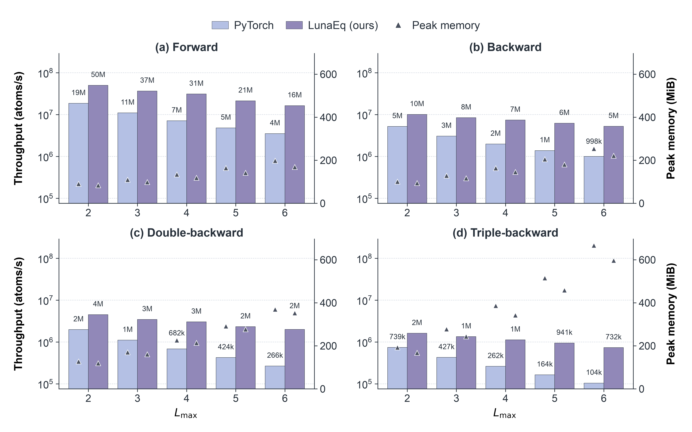

# Feed-Forward Network

````{py:function} LunaEquivariance.so2.feed_forward(x, input_weight, output_weight, gate_weight, *, input_bias, output_bias, gate_bias, to_grid=None, from_grid=None, grid_input_weight=None, grid_output_weight=None, norm_weight=None, norm_bias=None, norm_eps=1e-5, residual=False, scalar_branch=None, input_only=False)

Applies an equivariant gated feed-forward network to degree-major node
features using caller-owned weights.

Optional degree normalization (`norm_weight`, `norm_bias`) can run before the
input projection, and `residual=True` adds `x` to the output. All linear biases
apply only to degree `0` (scalar features). Derivatives with respect to inputs
and parameters are supported through third order (with `input_only=False`). Two
gating modes are supported:

- **Coefficient mode** (default, when grid arguments are `None`): `Hin == Hout == H`. Each degree `l` is projected from `Cin` to `H`, while scalar inputs `x[:, 0]` produce `lmax * H` gate logits via `gate_weight` and `gate_bias`. Degree `0` uses `SiLU`, and each degree `l > 0` is multiplied by `sigmoid(SiLU(logits))` before the degree-wise output projection to `Cout`.
- **Grid mode** (when `to_grid`, `from_grid`, `grid_input_weight` and `grid_output_weight` are provided): each degree is projected from `Cin` to `Hin`, expanded by `grid_input_weight` to `2 * H`, and mapped by `to_grid` onto `G` spherical grid points. On the grid, the two `H`-wide fields are multiplied and gated by `sigmoid(logits)` (from `x[:, 0]` via `gate_weight` and `gate_bias`), mapped back by `from_grid`, projected from `H` to `Hout` by `grid_output_weight`, and projected per degree to `Cout`. An optional `scalar_branch` runs a SwiGLU branch on `x[:, 0]` and merges it into degree `0` before the final degree map.

:param x: Degree-major node features of shape `(num_nodes, (lmax + 1) ** 2, Cin)`.
:type x: `torch.Tensor`
:param input_weight: Degree-wise input weights of shape `(lmax + 1, Hin, Cin)`, or `((lmax + 1) ** 2, Hin, Cin)` when `input_only=True` with per-component weights.
:type input_weight: `torch.Tensor`
:param output_weight: Degree-wise output weights of shape `(lmax + 1, Cout, Hout)`, or `((lmax + 1) ** 2, Cout, Hout)` when `input_only=True` with per-component weights.
:type output_weight: `torch.Tensor`
:param gate_weight: Scalar gate projection of shape `(lmax * H, Cin)` in coefficient mode, or `(H, Cin)` in grid mode.
:type gate_weight: `torch.Tensor`
:param input_bias: Scalar-degree input bias of shape `(Hin,)`. Grid mode also accepts `None`.
:type input_bias: `torch.Tensor or None`
:param output_bias: Scalar-degree output bias of shape `(Cout,)`. Grid mode also accepts `None`.
:type output_bias: `torch.Tensor or None`
:param gate_bias: Gate bias of shape `(lmax * H,)` in coefficient mode. Grid mode accepts shape `(H,)` or `None`.
:type gate_bias: `torch.Tensor or None`
:param to_grid: Optional forward spherical-grid transform of shape `(G, (lmax + 1) ** 2)`. Supply together with `from_grid`, `grid_input_weight` and `grid_output_weight`.
:type to_grid: `torch.Tensor or None`
:param from_grid: Optional inverse spherical-grid transform of shape `((lmax + 1) ** 2, G)`.
:type from_grid: `torch.Tensor or None`
:param grid_input_weight: Optional channel expansion weight of shape `(2 * H, Hin)` for grid mode.
:type grid_input_weight: `torch.Tensor or None`
:param grid_output_weight: Optional channel projection weight of shape `(Hout, H)` for grid mode.
:type grid_output_weight: `torch.Tensor or None`
:param norm_weight: Optional degree-normalization scale of shape `(lmax + 1, Cin)`. Supply together with `norm_bias`.
:type norm_weight: `torch.Tensor or None`
:param norm_bias: Optional scalar-degree normalization bias of shape `(Cin,)`.
:type norm_bias: `torch.Tensor or None`
:param norm_eps: Epsilon for degree normalization when `norm_weight` and `norm_bias` are provided. Default: `1e-5`.
:type norm_eps: `float`
:param residual: Add `x` to the output. Requires `Cout == Cin`. Default: `False`.
:type residual: `bool`
:param scalar_branch: Optional `(weight, bias)` pair for grid mode, where `weight` has shape `(2 * Hout, Cin)` and `bias` has shape `(2 * Hout,)` or `None`.
:type scalar_branch: `tuple[torch.Tensor, torch.Tensor | None] or None`
:param input_only: Select the inference-style coefficient path with frozen parameters and first-order input gradients only. Not supported in grid mode. Default: `False`.
:type input_only: `bool`
:returns: Output node features of shape `(num_nodes, (lmax + 1) ** 2, Cout)`.

````

## Examples

```python
import torch
from LunaEquivariance import so2

num_nodes, lmax, cin, hidden, cout = 64, 4, 16, 16, 16
x = torch.randn(num_nodes, (lmax + 1) ** 2, cin, device="cuda", requires_grad=True)
w_in = torch.randn(lmax + 1, hidden, cin, device="cuda", requires_grad=True)
w_out = torch.randn(lmax + 1, cout, hidden, device="cuda", requires_grad=True)
w_gate = torch.randn(lmax * hidden, cin, device="cuda", requires_grad=True)
b_in = torch.zeros(hidden, device="cuda", requires_grad=True)
b_out = torch.zeros(cout, device="cuda", requires_grad=True)
b_gate = torch.zeros(lmax * hidden, device="cuda", requires_grad=True)

y = so2.feed_forward(
    x, w_in, w_out, w_gate,
    input_bias=b_in, output_bias=b_out, gate_bias=b_gate,
    residual=True,
)
y.square().mean().backward()
```

For grid mode with `scalar_branch`:

```python
num_grid, h_in, h_grid, h_out = 36, 16, 32, 16
rows = (lmax + 1) ** 2
to_grid = torch.randn(num_grid, rows, device="cuda")
from_grid = torch.randn(rows, num_grid, device="cuda")
w_grid_in = torch.randn(2 * h_grid, h_in, device="cuda", requires_grad=True)
w_grid_out = torch.randn(h_out, h_grid, device="cuda", requires_grad=True)
w_grid_gate = torch.randn(h_grid, cin, device="cuda", requires_grad=True)
b_grid_gate = torch.zeros(h_grid, device="cuda", requires_grad=True)
scalar_branch = (
    torch.randn(2 * h_out, cin, device="cuda", requires_grad=True),
    torch.zeros(2 * h_out, device="cuda", requires_grad=True),
)
y_grid = so2.feed_forward(
    x, w_in, w_out, w_grid_gate,
    input_bias=b_in, output_bias=b_out, gate_bias=b_grid_gate,
    to_grid=to_grid, from_grid=from_grid,
    grid_input_weight=w_grid_in, grid_output_weight=w_grid_out,
    scalar_branch=scalar_branch,
)
```

## Performance

FP32 benchmarks on NVIDIA H100.

- Input: 2,083 atoms, 64 channels per degree, `Lmax=2–6`
- Mode: coefficient gating



## Limitations

- Requires an NVIDIA GPU with compute capability 8.0 or later.
- `input_only=True` requires frozen parameters and supports first-order input gradients only.
- Supported dtypes: FP32.
