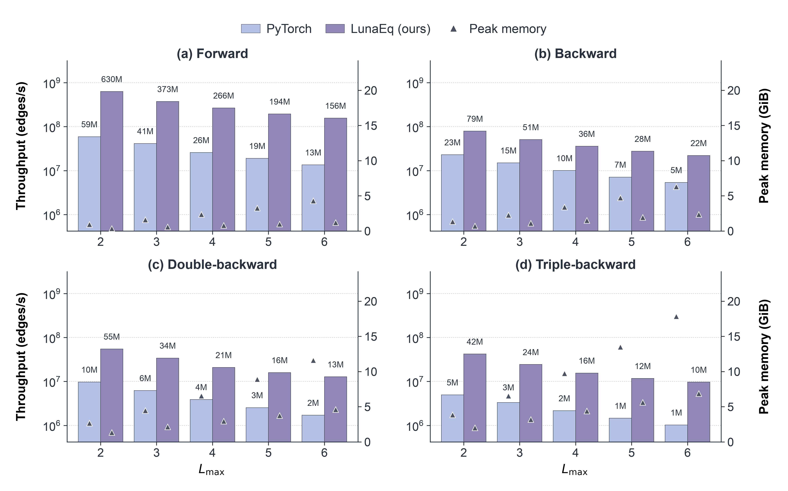

# Inverse Rotate and Reduce

````{py:function} LunaEquivariance.so2.inverse_rotate_reduce(raw, rotations, graph, *, lmax, mmax, edge_weight=None, logits=None, eps=1e-8)

Combines raw nonzero-order complex products from {py:func}`LunaEquivariance.so2.linear`,
rotates edge messages from local edge frames back to the global coordinate frame,
and aggregates them at each receiver node.

Two aggregation modes are supported:

- **Weighted sum** (`logits=None`): each edge message is scaled by `edge_weight` (defaulting to `1`) and summed at its receiver node.
- **Attention aggregation** (`logits` supplied): channels are split evenly across `num_heads` attention heads and weighted per receiver node {math}`v` using normalized edge weights:

```{math}
q_e = \exp\bigl(\text{logits}_e - \max_{r \in \mathcal{N}(v)} \text{logits}_r\bigr) \, a_e, \qquad
p_e = \frac{q_e}{\sum_{r \in \mathcal{N}(v)} q_r + \epsilon}, \qquad
\alpha_e = a_e \, p_e,
```

where {math}`a_e` is `edge_weight` and the per-receiver maximum is treated as a
constant during differentiation. Derivatives with respect to `raw`, `rotations`,
`edge_weight` and `logits` are supported through third order.

:param raw: Tuple of `mmax + 1` edge message tensors, typically from {py:func}`LunaEquivariance.so2.linear` with no auxiliary scalar channels. `raw[0]` may have shape `(num_edges, (lmax + 1) * channels)` or `(num_edges, lmax + 1, channels)`. With `mmax=0`, a single order-`0` tensor represents initial local-frame messages without a preceding complex projection.
:type raw: `sequence of torch.Tensor`
:param rotations: Compact inverse rotations of shape `(num_edges, K)` in the same layout as {py:func}`LunaEquivariance.so2.rotation`. For weighted sum (`logits=None`), `rotations` may retain more orders than `mmax`; for attention aggregation (`logits` provided), its retained order must equal `mmax`.
:type rotations: `torch.Tensor`
:param graph: Receiver-sorted `LunaTPGraph` (see [make_graph](../tensor_product_conv.md#graph-construction)).
:type graph: `LunaTPGraph`
:param lmax: Maximum angular degree {math}`L \ge 0`.
:type lmax: `int`
:param mmax: Maximum angular order of `raw`, with `0 <= mmax <= lmax`.
:type mmax: `int`
:param edge_weight: Optional edge envelope weights of shape `(num_edges,)` or `(num_edges, 1)`. `None` uses unit weights.
:type edge_weight: `torch.Tensor or None`
:param logits: Optional attention logits of shape `(num_edges, num_heads)` (for example, from {py:func}`LunaEquivariance.so2.attention_scores`). `channels` must be divisible by `num_heads`.
:type logits: `torch.Tensor or None`
:param eps: Positive constant added to the per-receiver softmax denominator when `logits` is provided. Default: `1e-8`.
:type eps: `float`
:returns: Aggregated global-frame node features of shape `(graph.num_nodes, (lmax + 1) ** 2, channels)`.

````

## Examples

```python
import torch
from LunaEquivariance import make_graph, so2

num_nodes, num_edges, channels = 16, 64, 8
lmax, mmax = 4, 2
src = torch.randint(0, num_nodes, (num_edges,), device="cuda")
dst = torch.randint(0, num_nodes, (num_edges,), device="cuda").sort().values
graph = make_graph(src, dst, num_nodes=num_nodes)

frames = torch.linalg.qr(torch.randn(num_edges, 3, 3, device="cuda")).Q
rot = so2.rotation(frames, lmax=lmax, mmax=mmax)
raw = (
    torch.randn(num_edges, (lmax + 1) * channels, device="cuda", requires_grad=True),
    *(torch.randn(num_edges, 2, 2 * (lmax + 1 - m) * channels, device="cuda", requires_grad=True) for m in range(1, mmax + 1)),
)
out = so2.inverse_rotate_reduce(raw, rot, graph, lmax=lmax, mmax=mmax)  # (num_nodes, (lmax + 1)**2, channels)
```

For attention aggregation, supply `logits` of shape `(num_edges, num_heads)`
where `channels` is divisible by `num_heads`:

```python
num_heads = 2
edge_weight = torch.rand(num_edges, device="cuda", requires_grad=True)
logits = torch.randn(num_edges, num_heads, device="cuda", requires_grad=True)
out_attn = so2.inverse_rotate_reduce(
    raw, rot, graph, lmax=lmax, mmax=mmax, edge_weight=edge_weight, logits=logits,
)
```

## Performance

FP32 benchmarks on NVIDIA H100.

- Graph: 2,083 atoms, 85,876 edges
- Features: 64 channels per degree, `Lmax=2–6`, `mmax=2`
- Aggregation: weighted sum (`logits=None`)



## Limitations

- Requires an NVIDIA GPU with compute capability 8.0 or later.
- `graph` must be a receiver-sorted `LunaTPGraph`.
- Supported dtypes: FP32.
