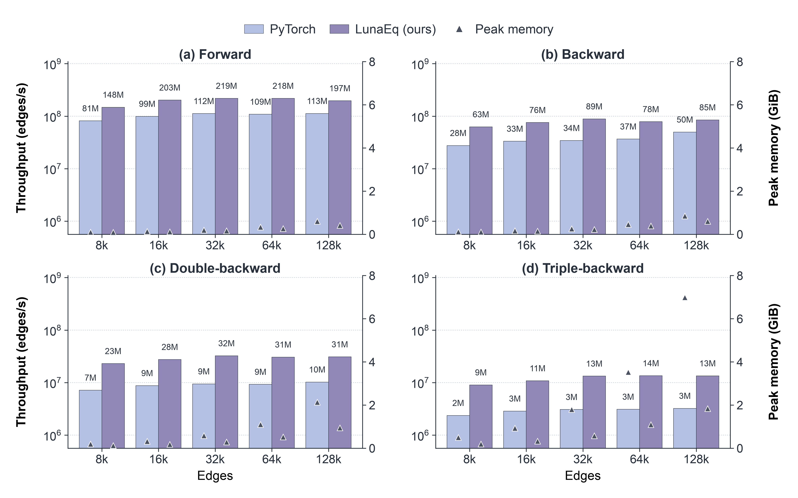

# Radial Network

````{py:function} LunaEquivariance.so2.radial_network(inputs, weights, biases, norm_weights, norm_biases, *, eps=1e-5, atom_types=None, edge_index=None, embeddings=None)

Evaluates a three-layer radial MLP (`Linear -> LayerNorm -> SiLU -> Linear -> LayerNorm -> SiLU -> Linear`)
on edge distance features using caller-owned parameter tensors. All floating
inputs and parameters support derivatives through third order.

Two optional extensions are supported:

- **Batched independent networks**: prepend a leading dimension `S` to every tensor in `weights`, `biases`, `norm_weights` and `norm_biases` (and optionally `embeddings`) to evaluate `S` independent networks sharing the same `inputs`.
- **Indexed atom-type embeddings**: pass `atom_types`, `edge_index` and `embeddings=(source_table, receiver_table)` so the first linear layer acts on `[inputs, source_embedding, receiver_embedding]` without materializing expanded edge embedding tensors.

:param inputs: Distance-basis or preassembled edge features of shape `(num_edges, D)`.
:type inputs: `torch.Tensor`
:param weights: Sequence of three linear weight matrices `(W1, W2, W3)` with shapes `(H1, Cin)`, `(H2, H1)`, `(Cout, H2)` (or `(S, ...)` for `S` independent networks). Without `embeddings`, `Cin == D`; with `embeddings` of width `B`, `Cin == D + 2 * B`.
:type weights: `sequence of torch.Tensor`
:param biases: Sequence of three bias vectors `(b1, b2, b3)` of lengths `H1`, `H2`, `Cout` (or `(S, width)`). `b1` and `b2` are required; `b3` may be `None`.
:type biases: `sequence of torch.Tensor | None`
:param norm_weights: Sequence of two LayerNorm scale vectors `(gamma1, gamma2)` of lengths `H1` and `H2` (or `(S, width)`).
:type norm_weights: `sequence of torch.Tensor`
:param norm_biases: Sequence of two LayerNorm bias vectors `(beta1, beta2)` of lengths `H1` and `H2` (or `(S, width)`).
:type norm_biases: `sequence of torch.Tensor`
:param eps: Positive finite LayerNorm epsilon, or a pair `(eps1, eps2)` for the two hidden stages. Default: `1e-5`.
:type eps: `float or sequence of float`
:param atom_types: Optional `torch.int64` tensor of shape `(num_nodes,)` indexing `embeddings`. Supply together with `edge_index` and `embeddings`.
:type atom_types: `torch.Tensor or None`
:param edge_index: Optional `torch.int64` tensor of shape `(2, num_edges)` giving source and receiver node indices.
:type edge_index: `torch.Tensor or None`
:param embeddings: Optional pair `(source_table, receiver_table)` of atom-type embedding tables, each of shape `(num_types, B)` or `(S, num_types, B)`.
:type embeddings: `sequence of torch.Tensor or None`
:returns: Edge radial weights of shape `(num_edges, Cout)`, or `(S, num_edges, Cout)` when batched across `S` networks.

````

## Examples

```python
import torch
from LunaEquivariance import so2

num_edges, d_in, h1, h2, d_out = 128, 32, 64, 64, 96
inputs = torch.randn(num_edges, d_in, device="cuda", requires_grad=True)
weights = (
    torch.randn(h1, d_in, device="cuda", requires_grad=True),
    torch.randn(h2, h1, device="cuda", requires_grad=True),
    torch.randn(d_out, h2, device="cuda", requires_grad=True),
)
biases = (
    torch.zeros(h1, device="cuda", requires_grad=True),
    torch.zeros(h2, device="cuda", requires_grad=True),
    torch.zeros(d_out, device="cuda", requires_grad=True),
)
norm_weights = (
    torch.ones(h1, device="cuda", requires_grad=True),
    torch.ones(h2, device="cuda", requires_grad=True),
)
norm_biases = (
    torch.zeros(h1, device="cuda", requires_grad=True),
    torch.zeros(h2, device="cuda", requires_grad=True),
)

out = so2.radial_network(inputs, weights, biases, norm_weights, norm_biases)  # (num_edges, d_out)
out.square().mean().backward()
```

To evaluate `S` independent networks with indexed atom-type embeddings:

```python
num_networks, num_nodes, num_types, b_emb = 3, 32, 10, 8
cin = d_in + 2 * b_emb
atom_types = torch.randint(0, num_types, (num_nodes,), device="cuda")
edge_index = torch.randint(0, num_nodes, (2, num_edges), device="cuda")
embeddings = (
    torch.randn(num_networks, num_types, b_emb, device="cuda", requires_grad=True),
    torch.randn(num_networks, num_types, b_emb, device="cuda", requires_grad=True),
)
s_weights = (
    torch.randn(num_networks, h1, cin, device="cuda", requires_grad=True),
    torch.randn(num_networks, h2, h1, device="cuda", requires_grad=True),
    torch.randn(num_networks, d_out, h2, device="cuda", requires_grad=True),
)
s_biases = (
    torch.zeros(num_networks, h1, device="cuda", requires_grad=True),
    torch.zeros(num_networks, h2, device="cuda", requires_grad=True),
    torch.zeros(num_networks, d_out, device="cuda", requires_grad=True),
)
s_norm_w = (
    torch.ones(num_networks, h1, device="cuda", requires_grad=True),
    torch.ones(num_networks, h2, device="cuda", requires_grad=True),
)
s_norm_b = (
    torch.zeros(num_networks, h1, device="cuda", requires_grad=True),
    torch.zeros(num_networks, h2, device="cuda", requires_grad=True),
)
out_batched = so2.radial_network(
    inputs, s_weights, s_biases, s_norm_w, s_norm_b,
    atom_types=atom_types, edge_index=edge_index, embeddings=embeddings,
)  # (num_networks, num_edges, d_out)
```

For a single network without atom-type embeddings, the equivalent PyTorch calculation is:

```python
import torch.nn.functional as F

h = F.silu(F.layer_norm(F.linear(inputs, weights[0], biases[0]), (h1,), norm_weights[0], norm_biases[0]))
h = F.silu(F.layer_norm(F.linear(h, weights[1], biases[1]), (h2,), norm_weights[1], norm_biases[1]))
out_ref = F.linear(h, weights[2], biases[2])
```

## Performance

FP32 benchmarks on NVIDIA H100.

- Input: 8,192–131,072 edges (`8k–128k`), 1 radial network
- Features: 64 radial input channels, 32 channels per indexed atom-type embedding, hidden and output widths 128



## Limitations

- Requires an NVIDIA GPU with compute capability 8.0 or later.
- Supported dtypes: FP32.
