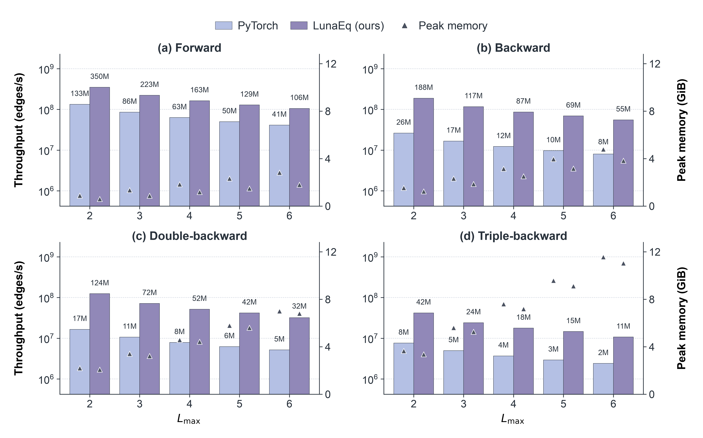

# Recombine and Activate

````{py:function} LunaEquivariance.so2.recombine_activate(raw, *, lmax, mmax, activation="gate", auxiliary_channels=0, to_grid=None, from_grid=None)

Combines the paired real/imaginary outputs from {py:func}`LunaEquivariance.so2.linear`,
applies a nonlinear activation, and returns local-frame order sectors together
with any leading auxiliary scalar channels. Derivatives with respect to `raw`
are supported through third order.

For each nonzero order {math}`m > 0`, reshaping `raw[m]` into
`(num_edges, 2, 2, lmax + 1 - m, C)` over `(input_plane, map, degree, channel)`
gives the complex recombination:

```{math}
y_{+m} = q_{:, 0, 0} - q_{:, 1, 1}, \qquad y_{-m} = q_{:, 1, 0} + q_{:, 0, 1}.
```

Two activation modes are supported:

- `"gate"`: `raw[0]` has shape `(num_edges, auxiliary_channels + lmax * C + (lmax + 1) * C)`. Any leading `auxiliary_channels` pass through unchanged, the next `lmax * C` values act as `sigmoid` gates for degrees `1..lmax` across all orders, and degree `0` of the `(lmax + 1) * C` order-`0` features uses `SiLU`.
- `"grid"`: `raw[0]` has shape `(num_edges, auxiliary_channels + 3 * C + (lmax + 1) * 2 * C)`, storing `auxiliary_channels`, three `C`-wide scalar blocks (scalar A, scalar B, and gate logits), and paired `(lmax + 1) * 2 * C` coefficients. Fixed `to_grid` and `from_grid` matrices transform the retained coefficients to a spherical grid, multiply the two grid fields, apply `sigmoid` gating, and transform back.

:param raw: Tuple of `mmax + 1` tensors produced by {py:func}`LunaEquivariance.so2.linear`.
:type raw: `sequence of torch.Tensor`
:param lmax: Maximum angular degree {math}`L \ge 0`.
:type lmax: `int`
:param mmax: Maximum retained local angular order {math}`M`, with `0 <= mmax <= lmax`.
:type mmax: `int`
:param activation: Activation mode. Default: `"gate"`.
:type activation: `{"gate", "grid"}`
:param auxiliary_channels: Number of leading scalar channels in `raw[0]` returned unchanged (for example, as inputs to {py:func}`LunaEquivariance.so2.attention_scores`). Default: `0`.
:type auxiliary_channels: `int`
:param to_grid: Fixed transform matrix of shape `(num_grid_points, R)` required when `activation="grid"`, where `R = sum((1 if m == 0 else 2) * (lmax + 1 - m) for m in range(mmax + 1))`.
:type to_grid: `torch.Tensor or None`
:param from_grid: Fixed inverse transform matrix of shape `(R, num_grid_points)` required when `activation="grid"`.
:type from_grid: `torch.Tensor or None`
:returns: Tuple `(sectors, auxiliary)`:

    - `sectors`: Tuple of `mmax + 1` sector tensors (`(num_edges, (lmax + 1) * C)` for order `0`, and `(num_edges, 2, (lmax + 1 - m) * C)` for order `m > 0`).
    - `auxiliary`: Leading scalar channels of shape `(num_edges, auxiliary_channels)`.

````

## Examples

```python
import torch
from LunaEquivariance import so2

num_edges, lmax, mmax, channels, aux = 64, 4, 2, 16, 4
raw = (
    torch.randn(num_edges, aux + (2 * lmax + 1) * channels, device="cuda", requires_grad=True),
    *(torch.randn(num_edges, 2, 2 * (lmax + 1 - m) * channels, device="cuda", requires_grad=True) for m in range(1, mmax + 1)),
)
sectors, auxiliary = so2.recombine_activate(
    raw, lmax=lmax, mmax=mmax, activation="gate", auxiliary_channels=aux
)
```

For `activation="gate"`, the equivalent PyTorch calculation is:

```python
import torch.nn.functional as F

auxiliary_ref = raw[0][:, :aux]
gates = raw[0][:, aux : aux + lmax * channels].reshape(num_edges, lmax, channels).sigmoid()
in0 = raw[0][:, aux + lmax * channels :].reshape(num_edges, lmax + 1, channels)
sec0 = torch.cat((F.silu(in0[:, :1]), in0[:, 1:] * gates), dim=1).reshape(num_edges, -1)
sec_m = []
for m in range(1, mmax + 1):
    w = lmax + 1 - m
    q = raw[m].reshape(num_edges, 2, 2, w, channels)
    recombined = torch.stack((q[:, 0, 0] - q[:, 1, 1], q[:, 1, 0] + q[:, 0, 1]), dim=1)
    sec_m.append((recombined * gates[:, m - 1 :].unsqueeze(1)).reshape(num_edges, 2, -1))
```

## Performance

FP32 benchmarks on NVIDIA H100.

- Input: 85,876 edges, 64 channels per degree, `Lmax=2–6`, `mmax=2`
- Activation: `activation="gate"`



## Limitations

- Requires an NVIDIA GPU with compute capability 8.0 or later.
- `to_grid` and `from_grid` must be fixed (`requires_grad=False`) tensors and are only accepted when `activation="grid"`.
- Supported dtypes: FP32.
