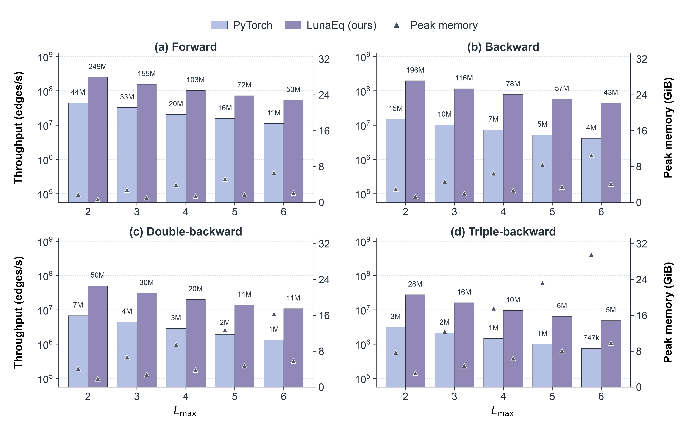

# Rotate and Gather

````{py:function} LunaEquivariance.so2.rotate_gather(x, rotations, radial, graph, *, lmax, mmax, radial_sharing="order_degree")

Gathers source and receiver node features onto each edge, rotates them into the
edge's local coordinate frame, multiplies by radial weights, and packs the
result by local angular order {math}`m`.

For each edge {math}`e = (u, v)`, this fuses gathering, Wigner-D rotation
{math}`D_e`, and radial scaling {math}`w_e` into a single pass without
allocating intermediate edge node tensors:

```{math}
\widetilde{x}_e = w_e \odot \bigl(D_e [x_u \,\|\, x_v]\bigr).
```

The outputs are split into one tensor per nonnegative order
{math}`m \in \{0, \dots, M\}` so that the next {py:func}`LunaEquivariance.so2.linear`
layer can mix degrees independently within each order. All three floating inputs
(`x`, `rotations`, `radial`) support derivatives through third order; `graph`
is fixed metadata.

:param x: Degree-major node features of shape `(num_nodes, (lmax + 1) ** 2, channels)`, with `num_nodes == graph.num_nodes`. Degree `l` occupies rows `l * l : (l + 1) ** 2`.
:type x: `torch.Tensor`
:param rotations: Compact forward rotations of shape `(num_edges, K)` returned by {py:func}`LunaEquivariance.so2.rotation`.
:type rotations: `torch.Tensor`
:param radial: Per-edge radial weights for the concatenated `(source, receiver)` endpoint channels:

    - `"order_degree"` sharing: shape `(num_edges, 2 * channels * G)`, where `G = sum(lmax + 1 - m for m in range(mmax + 1))`, ordered by `m = 0..mmax` then `l = m..lmax`. Both `+m` and `-m` share the same weights.
    - `"degree"` sharing: shape `(num_edges, lmax + 1, 2 * channels)`, with one weight map per degree shared across all retained orders.

:type radial: `torch.Tensor`
:param graph: Receiver-sorted `LunaTPGraph` (see [make_graph](../tensor_product_conv.md#graph-construction)). All edge tensors follow its edge order.
:type graph: `LunaTPGraph`
:param lmax: Maximum angular degree {math}`L \ge 0`.
:type lmax: `int`
:param mmax: Maximum retained local angular order {math}`M`, with `0 <= mmax <= lmax`.
:type mmax: `int`
:param radial_sharing: Radial weight sharing mode. Default: `"order_degree"`.
:type radial_sharing: `{"order_degree", "degree"}`
:returns: Tuple of `mmax + 1` sector tensors:

    - Order `0`: shape `(num_edges, (lmax + 1) * 2 * channels)`.
    - Order `m > 0`: shape `(num_edges, 2, (lmax + 1 - m) * 2 * channels)`, where axis 1 holds the `+m` and `-m` components.

````

## Examples

```python
import torch
from LunaEquivariance import make_graph, so2

num_nodes, num_edges, channels = 16, 64, 8
lmax, mmax = 4, 2
src = torch.randint(0, num_nodes, (num_edges,), device="cuda")
dst = torch.randint(0, num_nodes, (num_edges,), device="cuda").sort().values
graph = make_graph(src, dst, num_nodes=num_nodes)

x = torch.randn(num_nodes, (lmax + 1) ** 2, channels, device="cuda", requires_grad=True)
frames = torch.linalg.qr(torch.randn(num_edges, 3, 3, device="cuda")).Q
rot = so2.rotation(frames, lmax=lmax, mmax=mmax)

num_groups = sum(lmax + 1 - m for m in range(mmax + 1))
radial = torch.randn(num_edges, 2 * channels * num_groups, device="cuda", requires_grad=True)
sectors = so2.rotate_gather(x, rot, radial, graph, lmax=lmax, mmax=mmax)
```

## Performance

FP32 benchmarks on NVIDIA H100.

- Graph: 2,083 atoms, 85,876 edges
- Features: 64 channels per degree, `Lmax=2–6`, `mmax=2`
- Weights: `radial_sharing="order_degree"`



## Limitations

- Requires an NVIDIA GPU with compute capability 8.0 or later.
- `graph` must be a receiver-sorted `LunaTPGraph`.
- Supported dtypes: contiguous FP32.
