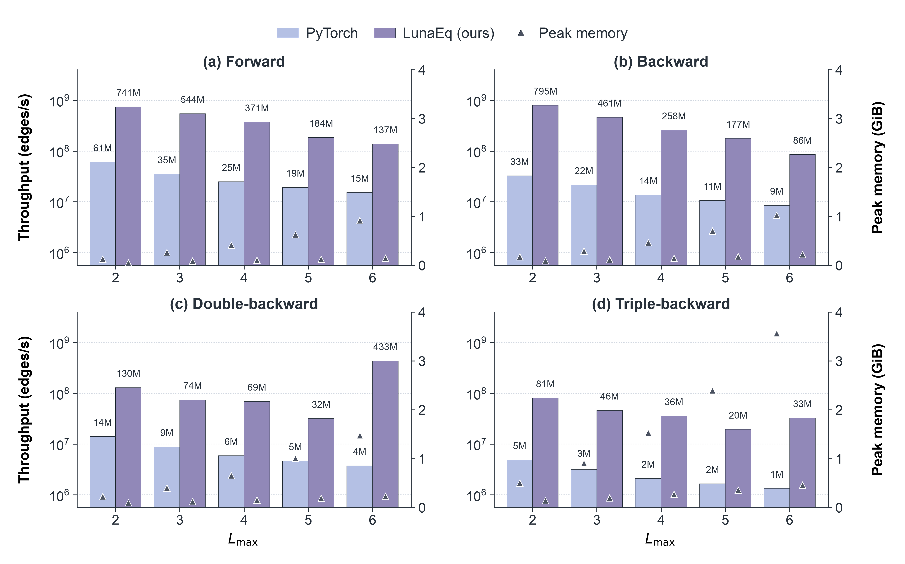

# Rotation

````{py:function} LunaEquivariance.so2.rotation(geometry, basis=None, *, lmax=None, mmax, convention=None, inverse_scale=None)

Builds compact Wigner-D rotation matrices from edge coordinate frames, keeping
only the rows needed up to local angular order `mmax` without materializing full
dense rotation matrices.

In an SO(2) edge convolution, rotating node features into an edge-aligned frame
couples components only within local angular order {math}`|m| \le M`. For each
edge frame {math}`R_e \in \mathbb{R}^{3 \times 3}` and degree
{math}`l \in \{0, \dots, L\}`, this operator keeps the {math}`2\min(l, M) + 1`
rows ordered as {math}`0, +1, -1, \dots`, each with {math}`2l + 1` columns. The
packed output width is:

```{math}
K = \sum_{l=0}^{L} (2\min(l, M) + 1)(2l + 1).
```

`geometry` supports derivatives through third order. `basis` and `inverse_scale`
are fixed constants.

:param geometry: Local coordinate frames of shape `(num_edges, 3, 3)` in CUDA FP32.
:type geometry: `torch.Tensor`
:param basis: Optional sequence of real-harmonic generator matrices {math}`J_l` of shape `(2*l + 1, 2*l + 1)` for `l = 0..L`. `None` uses the standard e3nn real-harmonic basis for `lmax`.
:type basis: `sequence of torch.Tensor or None`
:param lmax: Maximum angular degree {math}`L`. Required when `basis` is `None`; when `basis` is supplied, `lmax` must equal `len(basis) - 1` if given.
:type lmax: `int or None`
:param mmax: Maximum retained local angular order {math}`M`, with `0 <= mmax <= lmax`.
:type mmax: `int`
:param convention: Euler-angle convention near the coordinate poles. Default: `"pole_clamped"`.

    - `"pole_clamped"`: Clamped pole convention (eSEN-style).
    - `"masked"`: Masked pole convention (EquiformerV3-style).

:type convention: `{"pole_clamped", "masked"} or None`
:param inverse_scale: Optional fixed CUDA FP32 vector of shape `(K,)` used to rescale the inverse rotation entries. When supplied, returns `(forward, scaled_inverse)`.
:type inverse_scale: `torch.Tensor or None`
:returns: Packed forward rotations of shape `(num_edges, K)` when `inverse_scale` is `None`, or `(forward, scaled_inverse)` of two `(num_edges, K)` tensors otherwise.

````

## Examples

```python
import torch
from LunaEquivariance import so2

num_edges, lmax, mmax = 128, 4, 2
# Orthonormal local coordinate frames for each edge.
frames = torch.linalg.qr(torch.randn(num_edges, 3, 3, device="cuda")).Q.requires_grad_(True)
rot = so2.rotation(frames, lmax=lmax, mmax=mmax)  # (num_edges, K)
rot.square().mean().backward()
```

## Performance

FP32 benchmarks on NVIDIA H100.

- Input: 85,876 edge frames, `Lmax=2–6`, `mmax=2`
- Convention: `pole_clamped`



## Limitations

- Requires an NVIDIA GPU with compute capability 8.0 or later.
- `basis` and `inverse_scale` are fixed constants.
- Supported dtypes: FP32.
