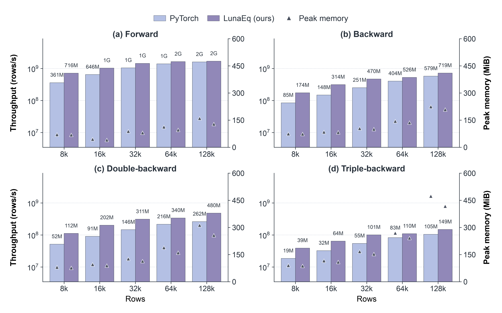

# Segmented Linear

````{py:function} LunaEquivariance.so2.segmented_linear(x, weights, coefficients, bias, sizes)

Applies per-segment linear transformations where each segment's weight matrix
is a linear combination of shared expert weights.

`sizes` partitions the leading axis of `x` into contiguous segments. For each
segment {math}`s`, the operator mixes the `num_experts` expert matrices
`weights` with that segment's `coefficients[s]` and applies the resulting
matrix to every row in segment {math}`s`:

```{math}
W_s = \sum_{k=1}^{K} c_{s, k} W_k, \qquad y_s = x_s W_s^T + b,
```

where {math}`c_{s, k}` is `coefficients[s, k]`, {math}`W_k` is `weights[k]`,
and {math}`b` is the optional shared `bias`. Mixing one weight matrix per
segment avoids materializing a separate weight tensor for every row. Derivatives
with respect to `x`, `weights`, `coefficients` and `bias` are supported through
third order.

:param x: Input tensor of shape `(N, ..., Cin)` with at least two dimensions.
:type x: `torch.Tensor`
:param weights: Expert weight bank of shape `(num_experts, Cout, Cin)`.
:type weights: `torch.Tensor`
:param coefficients: Segment mixing coefficients of shape `(num_segments, num_experts)`.
:type coefficients: `torch.Tensor`
:param bias: Optional shared bias of shape `(Cout,)`, or `None`.
:type bias: `torch.Tensor or None`
:param sizes: Sequence of `num_segments` nonnegative integers partitioning the leading axis `N` (`sum(sizes) == N`). Empty segments (`0`) are allowed.
:type sizes: `sequence of int`
:returns: Output tensor of shape `(N, ..., Cout)`.

````

## Examples

```python
import torch
from LunaEquivariance import so2

sizes = (16, 0, 24)
n, cin, cout, num_experts = sum(sizes), 16, 32, 4
x = torch.randn(n, cin, device="cuda", requires_grad=True)
weights = torch.randn(num_experts, cout, cin, device="cuda", requires_grad=True)
coefficients = torch.softmax(
    torch.randn(len(sizes), num_experts, device="cuda"), dim=-1
).requires_grad_(True)
bias = torch.zeros(cout, device="cuda", requires_grad=True)

y = so2.segmented_linear(x, weights, coefficients, bias, sizes)  # (n, cout)
y.square().mean().backward()
```

The equivalent PyTorch calculation is:

```python
import torch.nn.functional as F

mixed = torch.einsum("sk,koi->soi", coefficients, weights)
y_ref = torch.cat([F.linear(seg, w, bias) for seg, w in zip(x.split(sizes, dim=0), mixed)], dim=0)
```

## Performance

FP32 benchmarks on NVIDIA H100.

- Input: 8,192–131,072 rows (`8k–128k`) split into 4 equal segments
- Weights: 8 experts, 64 input and output channels



## Limitations

- `sizes` is fixed metadata and is not differentiable.
- Supported dtypes: FP32, FP64, FP16 and BF16 on CPU and CUDA.
