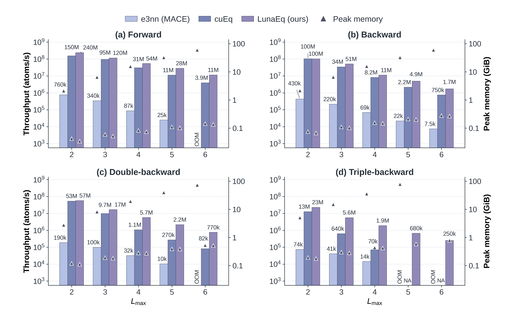

# SymmetricContraction

````{py:class} LunaEquivariance.o3.SymmetricContraction(irreps_in, irreps_out, correlation=3, *, num_elements, use_reduced_cg=True, dtype=None, device=None)

Contracts repeated copies of each input channel into the requested output
representations, with learnable weights for each element. Polynomial degrees
from 1 through `correlation` are included:

```{math}
y^{(l,p)}_{n,c,m}
= \sum_{\nu=1}^{\nu_{\max}}\sum_{s,\eta}
  a_{n,s}\,w^{(l,p,\nu)}_{s,\eta,c}
  \sum_{i_1,\ldots,i_\nu}
  U^{(l,p,\nu)}_{\eta,m,i_1,\ldots,i_\nu}
  \prod_{t=1}^{\nu}x_{n,c,i_t}.
```

`n` indexes atoms, `c` channels, `m` output irrep components, and `s` elements.
{math}`a` is `attrs`, {math}`\nu_{\max}` is `correlation`, and {math}`U` contains
real, component-normalized Clebsch–Gordan couplings for path {math}`\eta`.
Channels are contracted independently. Nonuniform multiplicities are supported:
channels align by index across irreps, with missing input channels treated as zero.

:param irreps_in: Nonempty input representations.
:type irreps_in: `str or Irreps`
:param irreps_out: Nonempty output representations.
:type irreps_out: `str or Irreps`
:param correlation: Maximum polynomial degree, a positive integer. Default: `3`.
:type correlation: `int`
:param num_elements: Number of element-specific weight sets, a positive integer.
:type num_elements: `int`
:param use_reduced_cg: Use an independent symmetric CG basis. Default: `True`.
:type use_reduced_cg: `bool`
:param dtype: Data type used to initialize the weights. `None` uses `torch.get_default_dtype()`.
:type dtype: `torch.dtype or None`
:param device: Device on which to initialize the weights.
:type device: `torch.device, str or None`

For uniform multiplicities, `weight` has shape `(num_elements, num_paths, num_channels)`.
Otherwise it has shape `(num_elements, weight_numel)`, packed by output block,
polynomial degree from `correlation` down to 1, coupling path, then channel.
The number of paths depends on `use_reduced_cg`; weights from the two bases are
not interchangeable.

```{py:method} forward(x, attrs)

:param x: For uniform multiplicities, shape `(num_atoms, num_channels, num_components)`, with one copy of each input irrep concatenated on the last axis. For nonuniform multiplicities, shape `(num_atoms, irreps_in.dim)` in `mul_ir` layout.
:type x: `torch.Tensor`
:param attrs: Floating-point element attributes of shape `(num_atoms, num_elements)`, with the same dtype as `x`. One-hot rows select an element; dense rows mix element weights linearly.
:type attrs: `torch.Tensor`
:returns: Tensor of shape `(num_atoms, irreps_out.dim)` in `mul_ir` layout.

```
````

## Function

```{py:function} LunaEquivariance.symmetric_contraction(x, weights, attrs, irreps_in, irreps_out, correlation=3, *, use_reduced_cg=True)

See the module parameters and input shapes above.

:param weights: Weights with the same dtype as `x` and the layout of `module.weight` described above. The first dimension determines `num_elements`.
:type weights: `torch.Tensor`
:returns: Tensor of shape `(num_atoms, irreps_out.dim)`.

```

## Examples

```python
import torch
import torch.nn.functional as F
from LunaEquivariance import o3, symmetric_contraction

contraction = o3.SymmetricContraction(
    "32x0e + 32x1o + 32x2e", "32x0e + 32x1o",
    correlation=3, num_elements=4, use_reduced_cg=True,
    dtype=torch.float32, device="cuda",
)
num_atoms = 1024
x = torch.randn(num_atoms, 32, 9, device="cuda", dtype=torch.float32, requires_grad=True)
attrs = F.one_hot(torch.randint(4, (num_atoms,), device="cuda"), num_classes=4).to(x.dtype)
y = contraction(x, attrs)  # (num_atoms, 128)
y.square().mean().backward()

functional = symmetric_contraction(
    x, contraction.weight, attrs, contraction.irreps_in, contraction.irreps_out,
    correlation=contraction.correlation,
    use_reduced_cg=contraction.use_reduced_cg,
)
torch.testing.assert_close(functional, y)

# Nonuniform multiplicities are also supported.
# contraction = o3.SymmetricContraction(
#     "128x0e + 64x1o + 32x2e", "64x0e + 32x1o",
#     correlation=4, num_elements=4, dtype=torch.float32, device="cuda",
# )
# x = torch.randn(num_atoms, 480, device="cuda", dtype=torch.float32)
# y = contraction(x, attrs)  # (num_atoms, 160)
```

## Performance

FP32 benchmarks on NVIDIA H100. The PyTorch baseline uses the MACE implementation.

- Input: 5,120 atoms, 128 channels per degree, `Lmax=2–6`
- Output: `128x0e + 128x1o`
- Contraction: `correlation=3`, `use_reduced_cg=True`, one-hot attributes for 89 elements



## Limitations

- Requires an NVIDIA GPU with compute capability 8.0 or later.
- CUDA FP32 and FP64 only; CPU and FP16/BF16 computation are not supported.
